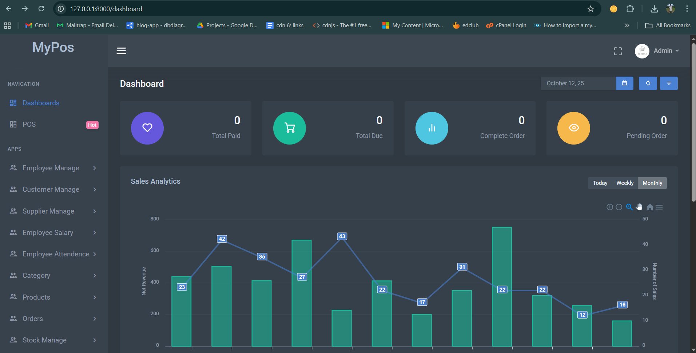

🛒 Laravel POS System with Employee Management

A powerful Point of Sale (POS) application built with Laravel, featuring advanced employee management, inventory tracking, and sales analytics.
Perfect for small and medium-sized businesses looking to streamline operations — from sales to staff management — all in one system.

🌟 Key Features
💼 Employee Management

Add, edit, or remove employees

Assign roles (Admin, Manager, Cashier, etc.)

Manage employee attendance and performance

Role-based access control and permissions

🏪 POS & Inventory

Real-time POS screen for quick sales

Product, category, and supplier management

Stock tracking with low-inventory alerts

Barcode scanning and product search support

💳 Billing & Transactions

Multiple payment methods (Cash, Card, etc.)

Discount and tax calculation

Receipt printing and PDF invoices

Sales return and refund options

📊 Reporting & Analytics

Daily, weekly, monthly sales reports

Employee sales performance analytics

Top-selling products and category reports

⚙️ System & Admin Panel

Dashboard overview of business KPIs

Business info setup (logo, tax, currency, etc.)

Secure authentication system

Responsive UI for desktop and tablet

🧩 Requirements

PHP >= 8.0

Composer

MySQL or MariaDB

Node.js & npm

Laravel >= 10.x

# 1️⃣ Clone the repository

git clone https://github.com/SandakalumSilva/my_pos
cd laravel-my_pos

# 2️⃣ Install dependencies

composer install
npm install && npm run build

# 3️⃣ Copy environment file and generate key

cp .env.example .env
php artisan key:generate

# 4️⃣ Set database credentials in .env

# Example:

# DB_DATABASE=laravel_pos

# DB_USERNAME=root

# DB_PASSWORD=

# 5️⃣ Run migrations and seed data

php artisan migrate --seed

# 6️⃣ Start the local development server

php artisan serve
